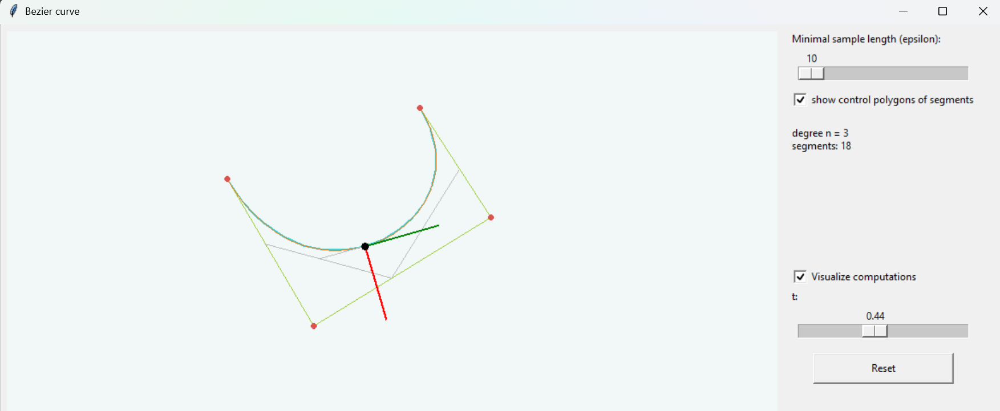

# Bézier Curve — Programming Assignment 1

**Course:** Modelling of Curves and Surfaces (1)  
**Topic:** Bézier Curve  
**Language:** Python 3  
**GUI:** Tkinter  
**Dependencies:** Python standard library only

## 1. Project Overview

This project is an interactive application for creating and visualizing Bézier curves using Python.

A Bézier curve is controlled by a set of points called **control points**. The user can add, move, and delete these points using the mouse. The application automatically updates the curve whenever the control points change.

The program also demonstrates adaptive subdivision, the de Casteljau algorithm, and the tangent and normal vectors of a Bézier curve.

## 2. Requirements

- Python 3.8 or newer.
- Tkinter.
- No additional Python packages are required.

## 3. How to Run

Open PowerShell or a terminal inside the project folder.

**Windows:**

```bash
py main.py
```

**macOS / Linux:**

```bash
python3 main.py
```

## 4. Application Screenshot



## 5. How to Use the Application

1. **Add points:** Left-click on the drawing area to create control points.
2. **Move points:** Click and drag an existing control point.
3. **Delete points:** Right-click on a control point.
4. **Change epsilon:** Use the Epsilon slider to control the subdivision level.
5. **Show refined polygons:** Enable the option to display the control polygons of the subdivided curves.
6. **Show de Casteljau construction:** Enable this option to visualize the interpolation process.
7. **Change parameter t:** Move the t slider to calculate different points on the curve.
8. **Reset:** Click the Reset / clear points button to remove all control points.

## 6. Mathematical Background

### 6.1 What is a Bézier Curve?

A Bézier curve is a parametric curve defined by a sequence of control points.

For a cubic Bézier curve, there are four control points:

- \(P_0\) — starting point
- \(P_1\) — first intermediate control point
- \(P_2\) — second intermediate control point
- \(P_3\) — ending point

The mathematical formula is:

$$
B(t)=(1-t)^3P_0+3(1-t)^2tP_1+3(1-t)t^2P_2+t^3P_3
$$

where:

$$
0\leq t\leq 1
$$

The curve starts at \(P_0\) and ends at \(P_3\). The intermediate control points influence the shape and direction of the curve.

### 6.2 de Casteljau Algorithm

The de Casteljau algorithm calculates a point on a Bézier curve using repeated linear interpolation between neighbouring points.

The interpolation formula is:

$$
\displaystyle b_i^k(t)=(1-t)b_i^{k-1}(t)+t\,b_{i+1}^{k-1}(t)
$$

Here:

- \(t\) is the parameter between 0 and 1.
- \(k\) represents the interpolation step.
- \(b\) represents the points calculated during the algorithm.

The process continues until only one point remains. This final point is the position of the Bézier curve at parameter \(t\).

The application displays the intermediate points and connecting lines to make this process visible.

### 6.3 Subdivision at \(t=\frac{1}{2}\)

The application divides a Bézier curve into two smaller curves using the de Casteljau algorithm at:

$$
t=\frac{1}{2}
$$

The first point from each interpolation row forms the control points of the left curve.

The last point from each row forms the control points of the right curve, after reversing their collected order.

Both resulting curves represent parts of the original Bézier curve.

### 6.4 Adaptive Refinement and Epsilon

Adaptive refinement is used to divide the curve into smaller segments.

The application checks the distance between neighbouring control points:

$$
\left\|P_{i+1}-P_i\right\|\geq\varepsilon
$$

If at least one edge satisfies this condition, the curve is subdivided again at \(t=\frac{1}{2}\).

The process continues until all edges of the final control polygons are shorter than epsilon, or the recursion safety limit is reached.

**Effect of epsilon:**

- Smaller epsilon generally produces more subdivisions and a more detailed approximation.
- Larger epsilon generally produces fewer subdivisions.
- The minimum value available in the slider is 10.

The application draws the approximation by connecting the endpoints of the final refined segments.

### 6.5 Tangent and Normal Vectors

A tangent vector describes the direction of the curve at a particular parameter \(t\).

For a Bézier curve of degree \(n\), the derivative is:

$$
B'(t)=n\left(b_1^{n-1}(t)-b_0^{n-1}(t)\right)
$$

A normal vector is perpendicular to the tangent vector.

If the tangent vector is:

$$
T=(a,b)
$$

one possible normal direction is:

$$
N=(-b,a)
$$

The application displays both vectors as arrows on the drawing area.

## 7. Main Source Code Structure

| Function / Class | Purpose |
|---|---|
| `interpolate` | Calculates linear interpolation between two points. |
| `de_casteljau` | Calculates the interpolation rows and the final curve point. |
| `subdivide_at_half` | Divides a Bézier curve into two smaller curves. |
| `has_edge_at_least_epsilon` | Checks whether a control polygon needs subdivision. |
| `refine_curve` | Recursively subdivides the curve. |
| `bezier_tangent` | Calculates the tangent direction. |
| `BezierApplication` | Creates the graphical interface and manages user interactions. |

## 8. Presentation Demonstration

The following sequence can be used to demonstrate the application:

1. Explain what a Bézier curve is and identify its control points.
2. Add four control points to the drawing area.
3. Show how moving a control point changes the curve.
4. Demonstrate deleting a control point.
5. Change epsilon and observe how the number of subdivisions changes.
6. Enable the de Casteljau construction.
7. Move the \(t\) slider and observe how the point on the curve changes.
8. Identify the tangent and normal vectors.
9. Briefly explain how the mathematical functions are connected to the graphical interface.

## 9. Implementation Notes

The recursive refinement function includes a maximum recursion depth of 24 to prevent excessive recursion.

If this limit is reached, a segment is returned even if its control polygon still contains an edge whose length is greater than or equal to epsilon.

The approximation follows the assignment's specified control-polygon edge-length condition. It does not use a separate flatness-error test.